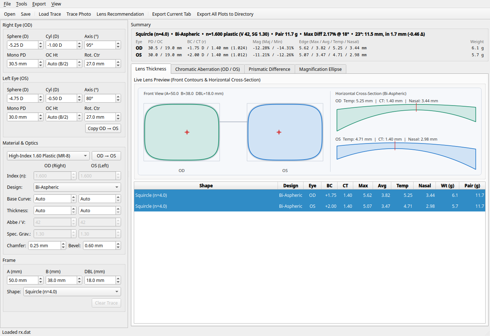

# optical-analyzer

`optical-analyzer` is a Go library, native Qt6 desktop application, and suite of CLI tools for ophthalmic spectacle lens analysis, physical thickness/weight modeling, material recommendation, and frame contour tracing.



## Analysis Techniques

- **Dynamic Spectacle Magnification (DSM)** — Models real spherocylindrical lenses using the ophthalmic optics framework of **Arnulf Remole** (School of Optometry, University of Waterloo). Rather than relying on thin-lens approximations such as Prentice's rule, DSM incorporates front base curve ($F_1$), center thickness ($t$), refractive index ($n$), meridional power, and back-vertex-to-center-of-rotation distance ($s$) to evaluate:
  - **Lateral Chromatic Aberration (OD / OS)** — per-eye lateral color spread heatmaps ($\Delta = P / V$) with frame contour overlays, dim-outside masking, a dashed 5 mm optical-center reference circle, a convergence-inset 23° reading point, and 30°/45° gaze ticks.
  - **Prismatic Difference** — binocular OD − OS induced prism heatmaps across the field of view and vertical prismatic imbalance at the converged 23° near-reading position (400 mm working distance).
  - **Magnification Ellipses** — OD and OS meridional magnification ellipses, shape factors, aniseikonia (maximum meridional magnification difference), and principal axes relative to a 1.00× reference circle.
- **Conic Sagitta Thickness, Volume & Weight Modeling** — Evaluates **Bi-Aspheric**, **Aspheric**, and **Spherical** surface designs across all 360 rim meridians using conic front/back sagitta geometry. Accounts for sphere, cylinder, axis, monocular PD decentration, optical center height (OCH), edge safety chamfer (`0.25 mm` default), eyewire V-bevel / groove depth (`0.60 mm` default), and 3D polar volume integration to estimate edge/center caliper thickness and single-lens / pair weight in grams.
- **Multi-Criteria Lens Material Recommendation** — Ranks 12 standard plastic and mineral glass materials using DSM ±30° chromatic dispersion clarity, maximum thickness, pair weight, relative material cost, and regional (US / EU) lab availability, with customizable priority ranking or explicit weights.
- **Occlusion-Aware Frame Photo Tracing & OMA/VCA Traces** — Extracts smooth, bilaterally symmetric 360-step OD/OS contours from front-view frame photos (combining Otsu color distance, Sobel edge detection, low-contrast metallic rim sealing, temporal sub-hole merging, convex-hull + Hermite occlusion bridging across temples and nosepad arms, raised-cosine Fourier smoothing, and OD/OS symmetrization) and reads/writes standard OMA/VCA (`.trc`/`.oma`), JSON, and SVG traces.

## Desktop GUI (`optical-analyzer`)

```bash
# Launch with default settings (plano Rx, Auto material, Bi-Aspheric, 52×40 DBL 18, Oval)
./optical-analyzer

# Launch with an optical data file (.json / .dat) and/or frame trace (.trc / .oma / .json / .svg)
./optical-analyzer -data rx.json
./optical-analyzer -data rx.json -trace frame.trc

# Render a headless screenshot and exit
./optical-analyzer -data rx.json -screenshot preview.png
```

### Interface Overview

- **Left Input Panel**:
  - **Right Eye (OD) / Left Eye (OS)**: Sphere, Cylinder, Axis, Monocular PD (`0` = auto `(A+DBL)/2`), OC Height (`0` = auto `B/2`), and Center of Rotation (`27.0 mm` default), plus `Copy OD → OS`.
  - **Material & Optics**: Material selector featuring **Auto** (automatically tracks the #1 recommended material, default when unspecified), 12 standard plastic and mineral glass presets, and **Custom** (unlocks manual Index, Abbe/V, and Specific Gravity editing; material-derived fields are disabled for all non-Custom selections), plus **Design** (`Bi-Aspheric`, `Aspheric`, `Spherical`), per-eye auto/manual **Base Curve** and **Thickness**, **Chamfer**, and **Bevel**.
  - **Frame**: Boxing dimensions (`A`, `B`, `DBL`), **Shape** (`Oval`, `Soft Rect`, `Squircle`, `Sharp Box`, or `Trace` automatically selected when a trace is loaded), and **Clear Trace**. The active frame contour drives every contour-aware tab and thickness calculation.
- **Unified Summary Panel**: Positioned above the tabs so optical and physical metrics stay visible across all views — active Shape/Design/Material, pair weight, max magnification difference (`% @ meridian°`), 23° reading drop, nasal convergence inset, and converged vertical prismatic difference (`Δ`), plus an aligned OD/OS readout (`PD / OC`, `BC / CT (r)`, `Mag`, `Max / Avg / Temp / Nasal` edge thickness, and per-eye weight).
- **Analysis Tabs**:
  1. **Lens Thickness** — Live front-view contour & horizontal meniscus cross-section preview and OD/OS caliper/weight table for the active Frame Shape and Lens Design (`Export → Export Lens Thickness Report...` exports JSON, CSV, or Text).
  2. **Chromatic Aberration (OD / OS)** — Per-eye lateral color spread heatmaps with `Show Contour`, `Show Box`, `Dim Outside` (on by default), per-tab zoom controls, and live hover inspection in the status bar.
  3. **Prismatic Difference** — Binocular OD − OS induced prism heatmap with per-tab zoom controls and live hover inspection.
  4. **Magnification Ellipse** — OD/OS meridional magnification ellipse comparison with per-tab zoom controls and full 6000×6000 PNG export.
- **Pop-out Tools** (toolbar and `Tools` menu):
  - **Frame Photo Tracer (`Trace Photo`)** — Load a front-view frame photo, calibrate `A` (and optional `B`, `DBL`, groove depth), inspect the live trace debug overlay preview, save in OMA/VCA `.trc` format, or click **Use Trace** directly.
  - **Lens Recommendation (`Lens Recommendation`)** — Interactive ranked table of all 12 materials with US/EU market selector, All/Plastic/Glass filter, reorderable priority chips, one-click **Apply #1**, and double-click to apply any material.

## CLI Tools

All five pure-Go CLI tools share the same optical models, defaults, and JSON data format as the GUI.

### Lens Thickness & Material Recommendation (`lens-thickness`)

```bash
# Calculate thickness and weight across preset shapes and designs
./lens-thickness \
  -odsph -5.25 -odcyl -1.00 -odaxis 85 -odpd 31.0 \
  -ossph -4.75 -oscyl -0.50 -osaxis 95 -ospd 30.5 \
  -index 1.67 -a 52 -b 40 -dbl 18

# Recommend and rank lens materials (DSM ±30° clarity > thickness > weight > cost > availability)
./lens-thickness -recommend -priority clarity,thickness,weight,cost,availability \
  -odsph -5.25 -odcyl -1.00 -odaxis 85 -odpd 31.0 \
  -ossph -4.75 -oscyl -0.50 -osaxis 95 -ospd 30.5 \
  -a 52 -b 40 -dbl 18

# Load an optical .json/.dat file (CLI flags override file values) and output JSON or CSV
./lens-thickness -data rx.json -format json
./lens-thickness -trace frame.trc -data rx.json -format csv > report.csv
```

Key flags: `-data`, `-trace`, `-trace-format`, `-odsph`/`-odcyl`/`-odaxis`/`-odpd`/`-odoch`, `-ossph`/`-oscyl`/`-osaxis`/`-ospd`/`-osoch`, `-index`, `-material` (`auto`, `plastic`, `glass`), `-sg`, `-bc`, `-thickness`, `-chamfer` (default `0.25`), `-bevel-depth` (default `0.6`), `-a`/`-b`/`-dbl`, `-shape` (`oval`, `softrect`, `squircle`, `box`, or exponent), `-design` (`spherical`, `aspheric`, `biaspheric`), `-recommend`, `-region` (`us`, `eu`), `-priority`, `-w-clarity`/`-w-thickness`/`-w-weight`/`-w-cost`/`-w-avail`, `-format` (`text`, `json`, `csv`), `-version`.

### Frame Photo Tracer (`lens-trace`)

```bash
# Trace a front-view frame photo to OMA .trc with a verification debug overlay
./lens-trace -image frame.jpg -a 52 -out frame.trc -debug-overlay debug.png

# Output JSON or SVG, or pipe OMA directly into lens-thickness
./lens-trace -image frame.jpg -a 52 -out frame.svg
./lens-trace -image frame.jpg -a 52 | ./lens-thickness -trace - -data rx.json
```

### DSM Plot Generators

```bash
# Lateral chromatic aberration (OD & OS PNGs, with optional trace overlay)
./chromatic-aberration -data rx.json -trace frame.trc -dim-outside -od od.png -os os.png

# Binocular prismatic difference heatmap
./prismatic-difference -data rx.json -out pdiff.png

# Meridional magnification ellipses (6000×6000 PNG)
./magnification-ellipse -data rx.json -out mag_ellipse.png
```

Shared flags: `-data` (or positional argument, or `-` for stdin), `-design` (`biaspheric`, `aspheric`, `spherical`), `-material` (`auto`, `plastic`, `glass`), `-version`, plus `-trace`, `-dim-outside`, `-no-box`, `-od`, `-os` for `chromatic-aberration`, `-out` for `prismatic-difference`, and `-out`, `-size` for `magnification-ellipse`.

## Data File Format (`.json` / `.dat`)

Optical configurations use a validated 4-section `snake_case` JSON format (`rx`, `lenses`, `frame`, `fit`, with optional `"version": 1`) with **millimeters (mm)** used consistently for all linear dimensions. When saving from the GUI, fields matching their defaults are omitted and trace paths are stored relative to the config file for portability:

```json
{
  "version": 1,
  "rx": {
    "od": { "sph": -5.25, "cyl": -1.00, "axis": 95 },
    "os": { "sph": -4.75, "cyl": -0.50, "axis": 80 }
  },
  "lenses": {
    "material": "1.60-plastic",
    "design": "aspheric"
  },
  "frame": {
    "a": 50.0,
    "b": 38.0,
    "dbl": 18.0,
    "shape": "squircle"
  },
  "fit": {
    "center_of_rotation": 27.0,
    "od": { "pd": 30.5 },
    "os": { "pd": 30.0 }
  }
}
```

| Field | Units | Default when `0` or omitted |
| --- | --- | --- |
| `version` | int | `1` (optional; unsupported versions rejected) |
| `rx.{od,os}.{sph,cyl,axis}` | D / deg | `0` (`cyl` and `axis` omitted when zero; `axis` in `[0, 180]`) |
| `lenses.material` | string | `"auto"` in GUI (`"1.50-plastic"` in CLI normalization); accepts any catalog key (e.g. `"1.60-plastic"`, `"1.67-plastic"`, `"1.90-glass"`) or alias (`"cr39"`, `"trivex"`, `"polycarbonate"`, `"crown"`) |
| `lenses.design` | string | `"biaspheric"` (`"aspheric"`, `"spherical"`) |
| `lenses.chamfer` | mm | `0.25` mm when omitted (`null`); explicit `0` preserved |
| `lenses.bevel_depth` | mm | `0.60` mm when omitted (`null`); explicit `0` preserved for rimless |
| `lenses.{index,family,abbe,specific_gravity}` | — | Shared custom material properties inherited by both eyes (optional per-eye overrides under `lenses.{od,os}`) |
| `lenses.{od,os}.base_curve` | D (1.530 tooling) | Estimated from `SE = sph + cyl/2` and lens design |
| `lenses.{od,os}.center_thickness` | mm | Estimated from material minimums, conic sag, Rx, edging, and contour |
| `frame.{a,b,dbl}` | mm | `52.0` / `40.0` / `18.0` (or derived from `frame.trace`) |
| `frame.shape` | string | `"oval"` (`"softrect"`, `"squircle"`, `"box"`, `"trace"`, or superellipse exponent) |
| `frame.trace` / `frame.trace_format` | path / string | Resolved relative to the config file's directory across the GUI and all CLIs |
| `fit.center_of_rotation` | mm | `27.0` mm (shared default; optional per-eye override at `fit.{od,os}.center_of_rotation`) |
| `fit.{od,os}.pd` | mm | `(a + dbl) / 2` |
| `fit.{od,os}.och` | mm | `b / 2` |

### Auto Base Curve Rules

Base curves are rounded to `0.25 D` and clamped to `[0.50, 12.00]` D (with `SE = Sph + Cyl / 2`):

- **Bi-Aspheric** (default): `0.40·SE + 4.00` (minus) / `0.60·SE + 4.00` (plano/plus)
- **Aspheric**: `0.50·SE + 5.00` (minus) / `0.75·SE + 4.75` (plano/plus)
- **Spherical**: `0.50·SE + 6.00` (minus) / `SE + 6.00` (plano/plus)

## Supported Materials

| Material | Index | Family | Abbe ($V$) | Default SG (g/cm³) | Min CT (minus) | Min ET (plus) | Rel. Cost |
| --- | ---: | --- | ---: | ---: | ---: | ---: | ---: |
| CR-39 Plastic | `1.50` | `plastic` | `58` | `1.32` | `2.0 mm` | `1.5 mm` | `1.0×` |
| Crown Glass | `1.523` | `glass` | `59` | `2.54` | `2.2 mm` | `1.8 mm` | `1.4×` |
| Trivex | `1.53` | `plastic` | `45` | `1.11` | `1.3 mm` | `1.2 mm` | `2.3×` |
| Polycarbonate | `1.59` | `plastic` | `30` | `1.20` | `1.3 mm` | `1.2 mm` | `1.5×` |
| High-Index 1.60 Plastic (MR-8) | `1.60` | `plastic` | `42` | `1.30` | `1.4 mm` | `1.3 mm` | `2.6×` |
| High-Index 1.60 Glass | `1.60` | `glass` | `42` | `2.65` | `2.0 mm` | `1.6 mm` | `2.1×` |
| High-Index 1.67 Plastic (MR-7/10) | `1.67` | `plastic` | `32` | `1.35` | `1.5 mm` | `1.3 mm` | `3.4×` |
| High-Index 1.70 Plastic (EYRY) | `1.70` | `plastic` | `36` | `1.41` | `1.0 mm` | `1.2 mm` | `4.4×` |
| High-Index 1.70 Glass | `1.70` | `glass` | `39` | `3.20` | `1.8 mm` | `1.5 mm` | `3.2×` |
| High-Index 1.74 Plastic (MR-174) | `1.74` | `plastic` | `33` | `1.47` | `1.6 mm` | `1.4 mm` | `5.0×` |
| High-Index 1.80 Glass | `1.80` | `glass` | `35` | `3.60` | `1.6 mm` | `1.5 mm` | `5.3×` |
| High-Index 1.90 Glass (Lantal) | `1.90` | `glass` | `31` | `4.00` | `1.5 mm` | `1.5 mm` | `7.0×` |

## OMA/VCA `.trc` Frame Traces

The trace loader supports standard `.trc` / `.oma` files (as well as `.json` and `.svg` contours):

- **Formats**: `TRCFMT` Format `1` (ASCII absolute), `2` (16-bit LE binary absolute), `3` (binary differential), `4` (packed binary), and `5` (ASCII differential), including OMA `ESC` (`0x1B`) binary transport unescaping.
- **Spacing**: Both equiangular (`E`) and unequiangular (`U`/`A` with `A=` records).
- **Orientation & Alignment**: Standard front-view polar convention (`0°` at 3 o'clock, counter-clockwise), normalized to the geometric boxing center. Single-eye (`R` or `L`) traces are automatically mirrored horizontally for the opposite eye.

## Repository Structure

```text
.
├── contour/                   # 360-step polar contours & full OMA/VCA, JSON, and SVG trace I/O
├── docs/                      # Documentation assets (GUI screenshot)
├── dsm/                       # Remole DSM optical magnification/prism model and plot renderers
├── lens/                      # 3D conic thickness/volume/weight modeling and material recommendations
├── optics/                    # Shared RX/Data JSON format, canonical material catalog, base curve & conic sagitta
├── packaging/
│   ├── linux/                 # Desktop entry, AppStream metadata, and SVG icon
│   ├── flatpak/               # Flatpak manifest and offline Go modules manifest
│   ├── macos/                 # macOS .app bundle Info.plist
│   └── windows/               # Windows ICO/RC icon resources and Inno Setup installer script
├── tracer/                    # Occlusion-aware front-view frame photo segmentation & contour extraction
└── cmd/
    ├── optical-analyzer/      # Native Qt6 desktop GUI
    ├── chromatic-aberration/  # CLI lateral chromatic aberration heatmap generator
    ├── prismatic-difference/  # CLI binocular prismatic difference heatmap generator
    ├── magnification-ellipse/ # CLI meridional magnification ellipse plot generator
    ├── lens-thickness/        # CLI thickness, weight, and material recommendation tool
    └── lens-trace/            # CLI front-view frame photo tracer
```

## Building

All library packages and all five CLI tools are pure Go (**Go 1.24+**) and require no Qt6 or CGO on Linux, macOS, or Windows. Only the desktop GUI (`cmd/optical-analyzer`) requires a C++17 compiler, `pkg-config`, and Qt 6 development libraries (via `github.com/mappu/miqt`).

The first build of `optical-analyzer` compiles `miqt/qt6`'s C++ bindings and may take a minute or two; subsequent builds reuse the Go build cache.

### Linux

Install **Go 1.24+**, a C++ compiler, `pkg-config`, and Qt 6 development headers:

```bash
# Fedora
sudo dnf install golang gcc-c++ pkgconf-pkg-config qt6-qtbase-devel

# Debian / Ubuntu
sudo apt install golang-go g++ pkg-config qt6-base-dev

# Arch Linux
sudo pacman -S go base-devel pkgconf qt6-base
```

Build the CLI tools and desktop GUI:

```bash
# Pure-Go CLI tools
go build -ldflags '-s -w' ./cmd/lens-thickness
go build -ldflags '-s -w' ./cmd/lens-trace
go build -ldflags '-s -w' ./cmd/chromatic-aberration
go build -ldflags '-s -w' ./cmd/prismatic-difference
go build -ldflags '-s -w' ./cmd/magnification-ellipse

# Native Qt6 desktop GUI
go build -ldflags '-s -w' ./cmd/optical-analyzer
```

#### Flatpak (Linux)

Offline Flatpak packaging files live under [`packaging/flatpak/`](packaging/flatpak/) (with shared desktop metadata and icon in [`packaging/linux/`](packaging/linux/)). Dependencies are listed in [`packaging/flatpak/go.mod.yml`](packaging/flatpak/go.mod.yml) and [`packaging/flatpak/modules.txt`](packaging/flatpak/modules.txt) so the build runs completely offline with `-mod=vendor`.

```bash
# Install the KDE Qt 6 runtime/SDK, Go SDK extension, and Flatpak Builder once
flatpak install --user flathub org.flatpak.Builder org.kde.Platform//6.10 org.kde.Sdk//6.10 org.freedesktop.Sdk.Extension.golang//25.08

# Build and install locally for the current user
flatpak run org.flatpak.Builder --user --install --force-clean build-dir packaging/flatpak/net.jsouthworth.OpticalAnalyzer.yml
flatpak run net.jsouthworth.OpticalAnalyzer

# Run any of the bundled CLI tools inside the Flatpak
flatpak run --command=lens-thickness net.jsouthworth.OpticalAnalyzer -h

# Or export a single-file .flatpak bundle
flatpak run org.flatpak.Builder --repo=repo --force-clean build-dir packaging/flatpak/net.jsouthworth.OpticalAnalyzer.yml
flatpak build-bundle repo optical-analyzer.flatpak net.jsouthworth.OpticalAnalyzer
```

*(When updating `go.mod` / `go.sum`, regenerate `packaging/flatpak/go.mod.yml` and `packaging/flatpak/modules.txt` with `flatpak-go-mod`.)*

### macOS

1. Install Xcode Command Line Tools and dependencies via [Homebrew](https://brew.sh/):

   ```bash
   xcode-select --install
   brew install go pkg-config qtbase
   ```

   *(Using `qtbase` installs only the core Qt 6 libraries needed by `optical-analyzer`. If you already have the full `qt` formula installed, you can use that instead.)*

2. Point `pkg-config` at Homebrew's Qt 6 `.pc` files (works on both Apple Silicon `/opt/homebrew` and Intel `/usr/local`):

   ```bash
   export PKG_CONFIG_PATH="$(brew --prefix qtbase)/lib/pkgconfig:${PKG_CONFIG_PATH}"
   pkg-config --modversion Qt6Widgets   # should print your Qt 6 version (e.g. 6.x.x)
   ```

   *(Add the `export PKG_CONFIG_PATH=...` line to `~/.zshrc` to persist across shells. If you changed `PKG_CONFIG_PATH` after a failed build, run `go clean -cache` before rebuilding.)*

3. Build the CLI tools and desktop GUI:

   ```bash
   # Pure-Go CLI tools (no Qt6 / PKG_CONFIG_PATH required)
   go build -ldflags '-s -w' ./cmd/lens-thickness
   go build -ldflags '-s -w' ./cmd/lens-trace
   go build -ldflags '-s -w' ./cmd/chromatic-aberration
   go build -ldflags '-s -w' ./cmd/prismatic-difference
   go build -ldflags '-s -w' ./cmd/magnification-ellipse

   # Native Qt6 desktop GUI
   go build -ldflags '-s -w' ./cmd/optical-analyzer
   ```

### Windows

#### Desktop GUI & CLI Tools (MSYS2 UCRT64)

Building the Qt 6 GUI natively on Windows requires a MinGW-w64 GCC/Clang toolchain via [MSYS2](https://www.msys2.org/) (MSVC is not compatible with CGO for `miqt`).

1. Install [MSYS2](https://www.msys2.org/) and open the **MSYS2 UCRT64** terminal (not the default `MSYS` shell).
2. Update MSYS2 and install Go, GCC, `pkg-config`, and Qt 6 Base:

   ```bash
   pacman -Syu
   pacman -S mingw-w64-ucrt-x86_64-{go,gcc,pkg-config,qt6-base}
   ```

   If this is the first time installing Go in MSYS2, either reopen the **MSYS2 UCRT64** terminal or set `GOROOT` in your current shell:

   ```bash
   export GOROOT=/ucrt64/lib/go
   pkg-config --modversion Qt6Widgets   # should print your Qt 6 version (e.g. 6.x.x)
   ```

3. Build the CLI tools and desktop GUI (passing `-H windowsgui` hides the background console window for the GUI):

   ```bash
   # Pure-Go CLI tools
   go build -ldflags '-s -w' -o lens-thickness.exe ./cmd/lens-thickness
   go build -ldflags '-s -w' -o lens-trace.exe ./cmd/lens-trace
   go build -ldflags '-s -w' -o chromatic-aberration.exe ./cmd/chromatic-aberration
   go build -ldflags '-s -w' -o prismatic-difference.exe ./cmd/prismatic-difference
   go build -ldflags '-s -w' -o magnification-ellipse.exe ./cmd/magnification-ellipse

   # Native Qt6 desktop GUI
   go build -ldflags '-s -w -H windowsgui' -o optical-analyzer.exe ./cmd/optical-analyzer
   ```

4. **Running outside the MSYS2 shell**: `optical-analyzer.exe` dynamically links against the MSYS2 Qt 6 and MinGW runtime DLLs. Either add `C:\msys64\ucrt64\bin` to your Windows `PATH`, or stage a standalone directory using `windeployqt6` and `ldd`:

   ```bash
   mkdir -p dist
   cp optical-analyzer.exe dist/
   windeployqt6 dist/optical-analyzer.exe
   ldd dist/optical-analyzer.exe | awk '/\/ucrt64\/bin\// {print $3}' | xargs -I{} cp -u {} dist/
   ```

#### CLI Tools Only (PowerShell / Command Prompt)

If you only need the five pure-Go CLI tools, install Go 1.24+ from [go.dev](https://go.dev/dl/) and build directly in PowerShell (no MSYS2 or Qt 6 required):

```powershell
go build -ldflags "-s -w" ./cmd/lens-thickness
go build -ldflags "-s -w" ./cmd/lens-trace
go build -ldflags "-s -w" ./cmd/chromatic-aberration
go build -ldflags "-s -w" ./cmd/prismatic-difference
go build -ldflags "-s -w" ./cmd/magnification-ellipse
```

## Testing

```bash
# Run all library, CLI, and headless Qt6 GUI tests
QT_QPA_PLATFORM=offscreen go test -v ./...

# Run only pure-Go packages (no Qt6 required)
go test ./contour ./optics ./dsm ./lens ./tracer ./cmd/chromatic-aberration ./cmd/prismatic-difference ./cmd/magnification-ellipse ./cmd/lens-thickness ./cmd/lens-trace
```

## References

The core Dynamic Spectacle Magnification model in [`dsm/dsm.go`](dsm/dsm.go) is based on **Arnulf Remole**'s work on Dynamic Spectacle Magnification and off-axis prismatic effects in spherocylindrical lenses:

- Remole, A. (2000). *A new method for determining prismatic effects in cylindrical spectacle corrections.* Optometry and Vision Science, 77(4), 211–220.
- Remole, A. (2001). *Compensating for vertical anisometropic imbalance by the positioning of segment centers.* Optometry and Vision Science, 78(7), 539–546.
- Remole, A. (2003). *The theory of object and image eccentricities: A new dimension in ophthalmic optics.* Optometry and Vision Science, 80(10), 708–719.
- Remole, A. *Dynamic spectacle magnification versus Prentice's rule and thin lens approximations.* (School of Optometry, University of Waterloo).

## License

This project is licensed under the [BSD Zero Clause License (0BSD)](LICENSE).

Note that `cmd/optical-analyzer` links against Qt 6 via `miqt` (MIT), so distributed GUI binaries are also subject to Qt's license terms (LGPLv3 or commercial).
